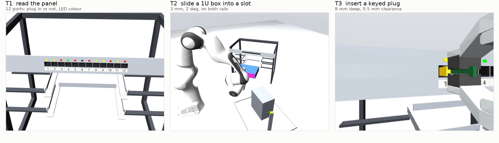
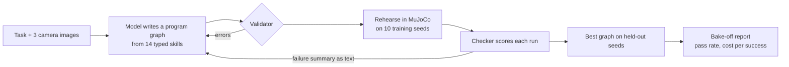

# loopkit

A frontier model writes a robot program from a typed skill library. MuJoCo rehearses it, a checker scores it, the failures go back to the model as text, and every call is traced. A bake-off runs the same loop across models and reports pass rate, cost per success and how many big-model calls each task needs.



## The loop



The model is called while the program is written and patched, never while it runs. On T2 and T3 the robot runs with no model in the loop, so runtime model calls are 0. On T1 the model reads the panel once per run.

## Status

Built and tested end to end. No real model has been called yet: every number so far comes from a scripted stand-in model and cost $0.

| | Result |
|---|---|
| Simulator | oracle programs pass T2 50/50 and T3 50/50 on dev seeds, doing nothing scores 0 |
| Skill library | the hand-written reference graph passes T2 20/20 and T3 20/20 on the S3 held-out seeds (not a clean held-out number, see the summary) |
| Bake-off pipeline | dry run of 6 models x 3 tasks x 3 repeats: 1,080 scored runs, full report and figure |
| Tests | 593 passing |
| Real models | waiting on an API key. The full bake-off is estimated at $27, capped at $40 |

The full picture, with every number and what it does and does not show, is in [reports/SUMMARY.md](reports/SUMMARY.md).

## Quickstart

Windows and PowerShell, Python 3.12 with [uv](https://docs.astral.sh/uv/).

```powershell
git clone --depth 1 https://github.com/google-deepmind/mujoco_menagerie third_party/mujoco_menagerie
copy .env.example .env          # add OPENROUTER_API_KEY, set LOOPKIT_DATA to a data folder
. .\env.ps1
uv sync
uv run pytest -q

uv run python -m loopkit.sim.oracles --task T2 --seeds 0-49 --program oracle   # scripted oracle, no model
uv run python -m loopkit.bakeoff.run --dry-run --models opus --tasks T2 --repeats 1   # whole pipeline, $0
uv run python -m loopkit.bakeoff.estimate                                       # cost of the full bake-off
powershell -ExecutionPolicy Bypass -File setup\start_bakeoff.ps1                # the real run, needs a key
```

## What is where

| Path | What it is |
|---|---|
| `loopkit/sim` | The rack_cell scene (Franka Panda, rack, patch panel, parts tray), tasks, checkers, oracles |
| `loopkit/skills` | 14 typed skills: classical-CV perception, motion, force-guarded manipulation, calibration |
| `loopkit/program` | The program writer, validate-and-repair, rehearse-and-patch |
| `loopkit/router` | One `chat()` for every provider, with a spend ledger and hard caps |
| `loopkit/bakeoff` | The resumable bake-off runner, report and cost estimate |
| `docs/` | Architecture, task suite, bake-off protocol, prior art |
| `reports/` | One report per build phase, and [SUMMARY.md](reports/SUMMARY.md) |

The code was built by Claude Code sessions from [KICKOFF.md](KICKOFF.md) and the prompts in `sessions/`, each phase ending in a report under `reports/`.

Personal project and prior IP of Kevin Hopkins.
